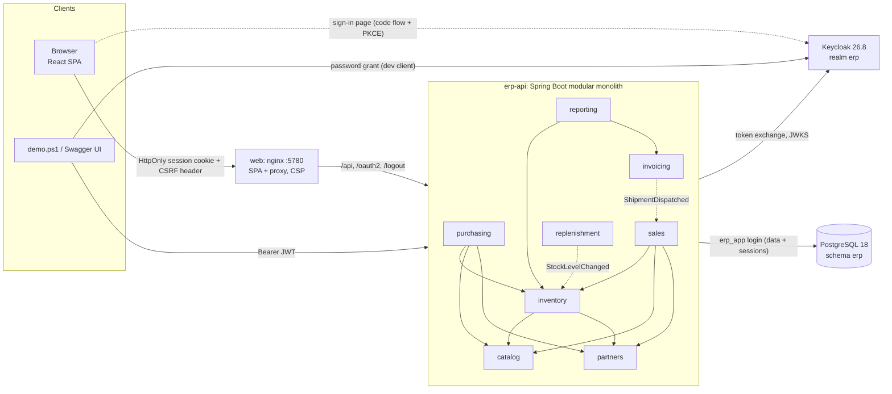
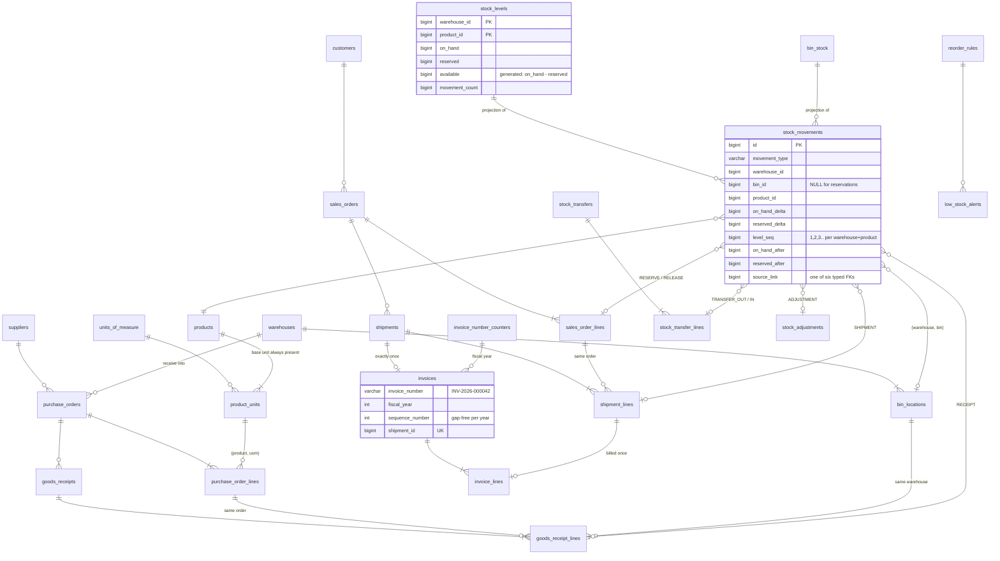

# Mini ERP: inventory, orders and warehouses

A small but serious ERP: purchase orders with approval, goods receipts into bin
locations across several warehouses, an **append-only stock ledger** with on-hand / reserved /
available balances derived from it, sales orders that **reserve stock safely under concurrency**,
shipments, inter-warehouse transfers, **gap-free invoice numbering**, low-stock alerts driven by
**domain events**, stock reports exported as **PDF and Excel**, and a **React web app** for every
role, signed in through a backend-for-frontend so that no token ever reaches the browser.

Java 25 · Spring Boot 4.2 · Spring Security 7 (Keycloak: JWT + OAuth2 login) · Spring Session ·
Hibernate 7 · Flyway · PostgreSQL 18 · Spring Modulith 2.2 · OpenPDF 3 · Apache POI 6 ·
Testcontainers 2 · React 19 · TypeScript 6 · Vite 8 · Tailwind 4 · TanStack Query · Docker Compose

```
.\scripts\init-env.ps1            # once: .env with random local secrets
docker compose up -d --build      # Postgres, Keycloak, the API, the web app
.\scripts\demo.ps1                # purchase -> receive -> reserve -> ship -> invoice -> alert -> transfer -> reports
```

Web app: **http://localhost:5780** (sign in as a demo user, below). API and Swagger UI:
http://localhost:8780/swagger-ui.html (get a token with `.\scripts\get-token.ps1 walt`).
Keycloak: http://localhost:8880.

## What it does

| Area | Highlights |
|---|---|
| Catalog | SKUs with a base unit of measure (EA, G, ML, ...) and per-product conversions (1 BOX = 12 EA). Typed quantities are converted exactly; "0.5 EA" is refused, never rounded |
| Warehouses | Several warehouses, each with bin locations and a RECEIVING bin |
| Purchasing | PO lifecycle DRAFT → SUBMITTED → APPROVED → PARTIALLY_RECEIVED → RECEIVED (+ reject, cancel, close short). Nobody approves their own PO. Partial goods receipts into chosen bins |
| Stock ledger | Every change is an immutable movement (RECEIPT, RESERVE, RELEASE, SHIPMENT, TRANSFER_OUT/IN, ADJUSTMENT) with its source document, actor and running balance. Balances are a projection maintained by the database |
| Sales | SO lifecycle DRAFT → CONFIRMED → PARTIALLY_SHIPPED → SHIPPED (+ cancel, close short). Confirm reserves every line, all or nothing. Shipments pick bins automatically |
| Transfers | Two-step: dispatch (IN_TRANSIT) and receive. Only available (unreserved) stock can leave |
| Invoicing | One invoice per shipment, issued automatically by an event listener; numbers INV-2026-000001, consecutive per fiscal year with no gaps; invoice PDF |
| Replenishment | Reorder point per warehouse and product; low-stock alerts OPEN → ACKNOWLEDGED → RESOLVED, kept in step with stock by events |
| Reports | Stock report (current, or rebuilt "as of" any past instant from the ledger) as PDF and .xlsx; the ledger as .xlsx; a reconciliation audit |
| Web app | Dashboard (alerts, work waiting), stock with each product's ledger, purchasing (raise, approve, receive), sales (take, confirm, ship, invoices), transfers, invoices with PDFs, reports and the audit, master data. Each screen shows exactly the actions the server allows the signed-in user |

## Architecture



One deployable, split into **Spring Modulith modules** (the sub-packages of `com.minierp`). A test
verifies that modules only use each other's public types and that their dependencies have no
cycles. Modules that react to something another module did (automatic invoicing, low-stock
alerts) listen to its **domain events** instead of being called, so sales doesn't know invoicing
exists, and the ledger doesn't know about alerts.

Events go through Modulith's **event publication registry**: an event is stored in the same
transaction as the change that raised it, delivered to each listener after commit (in a new
transaction, asynchronously), marked complete on success, and retried if the listener fails
(`EventPublicationMaintenance`). That's a transactional outbox without writing one; listeners are
idempotent because delivery is at least once.

## Data model



Normalisation notes:

- **Surrogate keys + business keys**: BIGINT identities, plus UNIQUE SKU / warehouse code / bin
  code per warehouse / document numbers.
- **Composite foreign keys as business rules.** A goods receipt line repeats `purchase_order_id`
  and `warehouse_id`, and references `(purchase_order_id, purchase_order_line_id)` and
  `(warehouse_id, bin_id)`: the database itself rejects receiving another order's line, or into a
  bin of another warehouse. The same pattern ties shipment lines to their order, invoice lines to
  their shipment, and every ledger movement to its source document *including product, warehouse
  and bin*, so a movement can't disagree with the document that caused it. The "superkey"
  `UNIQUE (id, x)` constraints exist to be targets of these keys.
- **Units**: `product_units (product_id, uom_code, base_units_per_uom)`; order lines reference
  `(product_id, uom_code)`, so an order can only use units the product is sold in. A trigger adds
  the base unit (factor 1) to every product.
- **Snapshots where the law wants them**: an invoice copies the customer's name and address at
  issue time; renaming a customer doesn't rewrite invoices already sent.
- **Derived values**: document totals aren't stored on headers (sum of lines); stock balances
  are stored, but only as a trigger-maintained projection of the ledger (see below).

## Design decisions

**The ledger is the truth; balances are a projection the database maintains.** Every stock change
is an INSERT into `stock_movements`. A `BEFORE INSERT` trigger (SECURITY DEFINER) applies the
movement to `stock_levels` and `bin_stock` in the same statement and records the balances after
it. The application's login has **no write privilege** on the balance tables and only
SELECT/INSERT on the ledger, so "balance = sum of movements" can't be broken by a bug, a missed
code path or a stray UPDATE. Stock can be rebuilt for any past instant from the ledger alone (the
stock report's `asOf` parameter does exactly that), and `/api/reports/reconciliation` recomputes
everything and compares.

**Reservations are ledger entries too.** RESERVE (+reserved), RELEASE (−reserved) and SHIPMENT
(−on hand and −reserved together, consuming the reservation) mean `reserved` is derived from the
ledger like `on hand`, and `available = on_hand − reserved` is a generated column.

**Concurrency: a row lock in the trigger, a fixed lock order in Java.** Two orders racing for the
last unit: the trigger does `SELECT ... FOR UPDATE` on the (warehouse, product) balance row, so
the second transaction waits, then sees what the first left and fails with SQLSTATE `ER001`
(mapped to 422 with the numbers). CHECK constraints (`reserved <= on_hand`, non-negative bins)
are the backstop. `StockLedger` sorts every batch of movements by (warehouse, product, bin), so
multi-line orders lock rows in the same order and can't deadlock. Proved by
`ReservationConcurrencyTests` (20 threads, 1 unit: exactly one wins; 25 orders, 10 units:
exactly 10; opposite line orders: no deadlock). Pessimistic locks on documents (`findForUpdate`)
serialise state changes of the same order; `@Version` protects draft edits.

**Confirm is all-or-nothing, with a friendly pre-check.** A plain read first reports every short
line at once; the locked re-check in the trigger is what actually guarantees correctness.

**Quantities in whole base units, money in minor units.** `long` everywhere stock or money is
added up. Typed quantities (NUMERIC(18,3) + unit) convert exactly or are refused. Money is
rounded HALF_UP once per line (amount, then tax); totals are sums of rounded lines, so an invoice
always adds up. `Math.addExact` turns overflow into an error.

**Explicit state machines.** `PurchaseOrderStatus`, `SalesOrderStatus`, `TransferStatus` and
`AlertStatus` are enums whose transitions are exhaustive `switch` expressions without `default`:
adding a status doesn't compile until every transition is decided. Tests hold the full tables.
Who may act is separate (`@PreAuthorize` + `PurchaseOrderAction.allowedRoles()`), and responses
include `allowedActions` for the caller, so a UI can show exactly the buttons the server allows.

**Gap-free invoice numbers.** A sequence can't do it (nextval isn't rolled back). One counter row
per fiscal year is incremented under a row lock in the invoice's own transaction; a rollback
undoes the increment. Three triggers make it a database guarantee: the counter moves +1 only, an
invoice must use the counter's current value, and (deferred to COMMIT) every drawn number must
have its invoice. The fiscal year is the issue date in the company's time zone. Trade-off:
invoicing is serialised per year, fine at this scale.

**Segregation of duties.** Six job roles in Keycloak. The person who raises a PO can't approve
it (403 `separation_of_duties`, and a CHECK constraint `approved_by <> created_by`); the
warehouse books goods but doesn't set prices; finance issues invoices.

**Least privilege in the database.** Flyway runs as `erp_owner`; the API runs as `erp_app`
with column-level UPDATE grants (a product's base unit, a document's warehouse or currency are
immutable), insert-only access to ledgers, receipts, shipments, invoices and histories, and
read-only access to balances.

**The API is the web app's backend-for-frontend; no token in the browser.** The SPA has no OIDC
library. Signing in is a full-page visit to `/oauth2/authorization/keycloak`: the API runs the
authorization-code flow with PKCE as the *confidential* client `erp-web`, keeps the tokens in a
server-side session (Spring Session, stored in Postgres), and gives the browser only the HttpOnly,
SameSite=Lax cookie `ERP_SESSION`. An XSS bug can't steal a token that isn't there. Because the
browser sends that cookie automatically, every POST/PUT also needs the CSRF token (cookie
`ERP-XSRF-TOKEN` copied into the `X-XSRF-TOKEN` header). `/api/**` without a session is 401, never
a redirect, so the SPA decides when to send the user to sign in. Sign-out ends the app session
and returns Keycloak's logout URL, which ends the Keycloak session too. Scripts and Swagger UI
keep using bearer tokens: a second, stateless filter chain handles any request that carries one.
nginx serves the SPA and proxies everything dynamic, so the browser talks to a single origin, and
its Content-Security-Policy allows no inline scripts and no connections elsewhere.

**The UI renders what the server allows.** Order responses carry `allowedActions`, `canEdit`,
`canReceive` and `canShip`, computed for the caller from status, roles and separation of duties;
the React screens show exactly those buttons and forms instead of re-implementing the rules.
Menus are filtered by role for convenience only: every endpoint checks again.

**Plain SQL where it fits.** JPA for documents (aggregates with lines); `JdbcClient` for the
ledger (`INSERT ... RETURNING` what the trigger computed), replenishment (`ON CONFLICT` on a
partial unique index) and reports.

## Invariants

| Invariant | Enforced by |
|---|---|
| Balances = sum of ledger movements | trigger-maintained projection; no write grant on balances; reconciliation test |
| Ledger, receipts, shipments, invoices, histories never change | append-only triggers + no UPDATE/DELETE grants + `@Immutable` |
| Available stock and bin stock never negative; reserved ≤ on hand | trigger checks (ER001/ER002) under a row lock + CHECK constraints |
| Two orders can't take the same unit | row lock in the trigger; concurrency tests |
| A movement matches its source document (product, warehouse, bin) | composite FKs; exactly-one-source CHECK; post-once unique indexes |
| Each movement's running balances and sequence are consistent | `level_seq` / `*_after` written under the lock; reconciliation check |
| Every confirmed line has exactly its open quantity reserved | reconciliation check (RESERVATION) |
| Lines reference units the product has | FK `(product_id, uom_code)` → `product_units` |
| Received ≤ ordered, shipped ≤ ordered | CHECK constraints + 422 checks |
| One invoice per shipment, each shipment line billed once | UNIQUE constraints; idempotent issuing |
| Invoice numbers consecutive per year, no gaps | locked counter + three triggers; concurrency and rollback tests |
| Nobody approves their own PO | service (403) + CHECK constraint |
| Module boundaries, no cycles | `ModularityTests` (Spring Modulith) |
| No token reaches the browser; state changes need CSRF | BFF session (HttpOnly cookie); CSRF on every POST/PUT; `BrowserSessionTests`, `smoke-web.ps1` |

## API tour

| | |
|---|---|
| `POST /api/products`, `/api/warehouses`, `/api/warehouses/{id}/bins`, `/api/suppliers`, `/api/customers` | master data (ADMIN) |
| `POST /api/purchase-orders`, `PUT /api/purchase-orders/{id}` | create / edit draft (PURCHASING) |
| `POST /api/purchase-orders/{id}/actions/{submit,approve,reject,cancel,close}` | lifecycle |
| `POST /api/purchase-orders/{id}/receipts` | goods receipt (WAREHOUSE) |
| `POST /api/sales-orders`, `.../actions/{confirm,cancel,close}` | sales (SALES) |
| `POST /api/sales-orders/{id}/shipments` | ship (WAREHOUSE) |
| `GET /api/stock/levels`, `/api/stock/bins`, `/api/stock/movements` | stock and the ledger |
| `POST /api/stock/adjustments` | count corrections (MANAGER) |
| `POST /api/transfers`, `/api/transfers/{id}/receive` | inter-warehouse transfers (WAREHOUSE) |
| `PUT /api/reorder-rules/{warehouseId}/{productId}`, `GET /api/alerts` | replenishment |
| `GET /api/invoices`, `POST /api/shipments/{id}/invoice`, `GET /api/invoices/{id}/pdf` | invoicing |
| `GET /api/reports/stock.pdf`, `/api/reports/stock.xlsx` (`?warehouseId=&asOf=`) | stock report |
| `GET /api/reports/stock-movements.xlsx`, `/api/reports/reconciliation` | audit |
| `GET /api/me`, `GET /oauth2/authorization/keycloak`, `POST /logout` | the web app's session: who am I, sign in, sign out |

Errors are RFC 9457 problem details: 404, 403 (`missing_role`, `separation_of_duties`), 409
(`invalid_transition`, `stale_version`, `pick_conflict`), 422 with `code`, `errors[]` and, for
stock, `shortages[]`.

## Tests

`mvnw verify` runs Checkstyle, `javac -Xlint:all -Werror`, and 68 tests against a real
PostgreSQL 18 (Testcontainers), with the app on its least-privileged login and real signed JWTs:

- **Concurrency**: last-unit race, N-units race, opposite lock orders (`ReservationConcurrencyTests`);
  concurrent invoicing (`InvoiceNumberingTests`); concurrent alert evaluation (`LowStockAlertTests`).
- **Ledger reconciliation**: random concurrent confirms, shipments, cancels and transfers, then
  a clean reconciliation; a deliberately corrupted balance is detected; stock rebuilt "as of"
  past instants (`ReconciliationTests`).
- **Database guarantees as the app login**: append-only ledger, no writes to balances, movement
  shapes, cross-warehouse bins refused, invoices immutable, counter rules (`StockLedgerDatabaseTests`, ...).
- **Flows over HTTP**: purchasing with segregation of duties, sales with reservations and
  automatic invoices, transfers, alerts, PDF/Excel exports parsed back, security (401/403).
- **Browser sessions** (`BrowserSessionTests`): `/api/me`, 401 instead of a redirect, CSRF
  required, roles from the ID token, the PKCE redirect to Keycloak, the Keycloak logout URL.
- **Pure logic**: full state-machine tables, unit conversion and rounding, module boundaries.

Run it (no local JDK needed):

```powershell
docker run --rm -v "${PWD}\services\erp-api:/workspace" -v mini-erp-m2:/root/.m2 -v /var/run/docker.sock:/var/run/docker.sock -e TESTCONTAINERS_HOST_OVERRIDE=host.docker.internal -w /workspace eclipse-temurin:25-jdk sh mvnw -B verify
```

The web app (`web/`): `npm test` (Vitest + Testing Library: the fetch client and CSRF header,
sign-in and sign-out, exact money and quantity parsing, and that the purchase order screen shows
exactly the server's allowed actions), `npm run lint`, `npm run build` (includes `tsc`).

Against the running stack, `.\scripts\smoke-web.ps1` signs in the way a browser does (Keycloak's
real login form, code exchange, session cookie), checks CSRF, then signs out and checks that the
next sign-in asks for the password again.

## Running locally

Only Docker Desktop and Windows PowerShell are needed (no JDK, Maven or Node: everything builds in
containers). `.\scripts\init-env.ps1` creates `.env` from `.env.example` with random secrets; don't
copy `.env.example` by hand, its passwords are empty on purpose and compose refuses to start
without them. Setting up a new machine from a zip, every test command, and troubleshooting:
[AGENTS.md, "Run it on a new machine"](AGENTS.md#run-it-on-a-new-machine).

| Port (127.0.0.1) | Service |
|---|---|
| 5780 | web app (nginx: the SPA, and the proxy to the API) |
| 8780 | erp-api (Swagger UI at `/swagger-ui.html`) |
| 8880 | Keycloak (realm `erp`, admin console user `admin`, password `KEYCLOAK_ADMIN_PASSWORD` in `.env`) |
| 37432 | PostgreSQL (database `erp`, schema `erp`) |

Demo users (password: `DEMO_USER_PASSWORD` in `.env`): `adam` ADMIN, `pam` PURCHASING,
`max` MANAGER, `bea` PURCHASING + MANAGER, `walt` WAREHOUSE, `sue` SALES, `finn` FINANCE.

`.\scripts\demo.ps1` walks the whole flow as those users and writes the invoice PDF, the stock
report (PDF and Excel) and a ledger export to `.\out\`. Start over with `docker compose down -v`
(also re-imports the Keycloak realm).

Web development with hot reload: `docker compose stop web`, then in `web/`: `npm install` and
`npm run dev` (Vite on the same port 5780, proxying to the API on 8780).

## Not in this milestone

In the order they'd best be built (details for each in
[AGENTS.md, "Status"](AGENTS.md#status-whats-built-and-whats-left)):

1. Editing draft orders in the web app (the API already supports it; the UI has no edit form yet).
2. Purchase suggestions from low-stock alerts (a draft PO from the preferred supplier).
3. Backorders (confirming is all-or-nothing today).
4. Payments, credit notes and customer returns.
5. Inventory valuation and FIFO costing.
6. Lot and serial tracking.
7. Multi-company tenancy.

Master data is create-only for now (no edit or deactivate screens), and the CI workflow hasn't
run yet (no remote repository).

## Learning from this project

[AGENTS.md, "Learning guide"](AGENTS.md#learning-guide) walks through the concepts in reading
order (schema design, the stock ledger, concurrency, state machines, events, gap-free numbering,
exports, the BFF, testing), with the files to read, a glossary and exercises.
